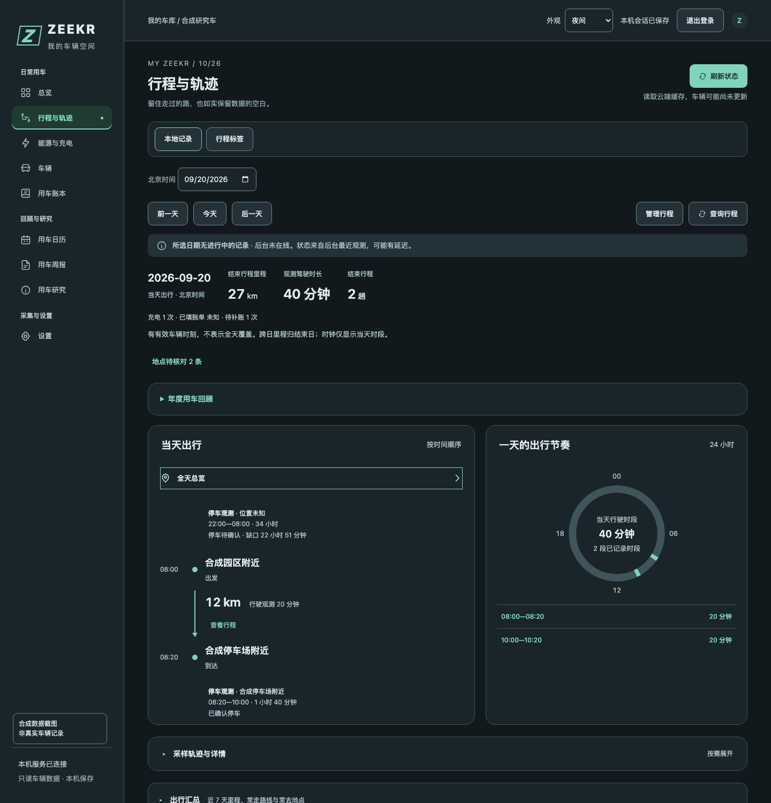
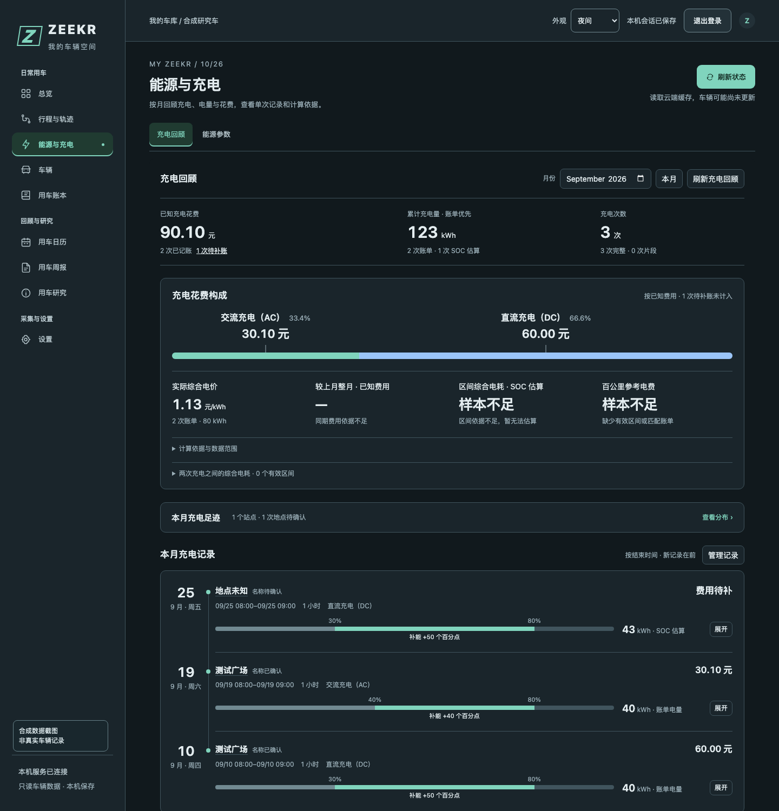
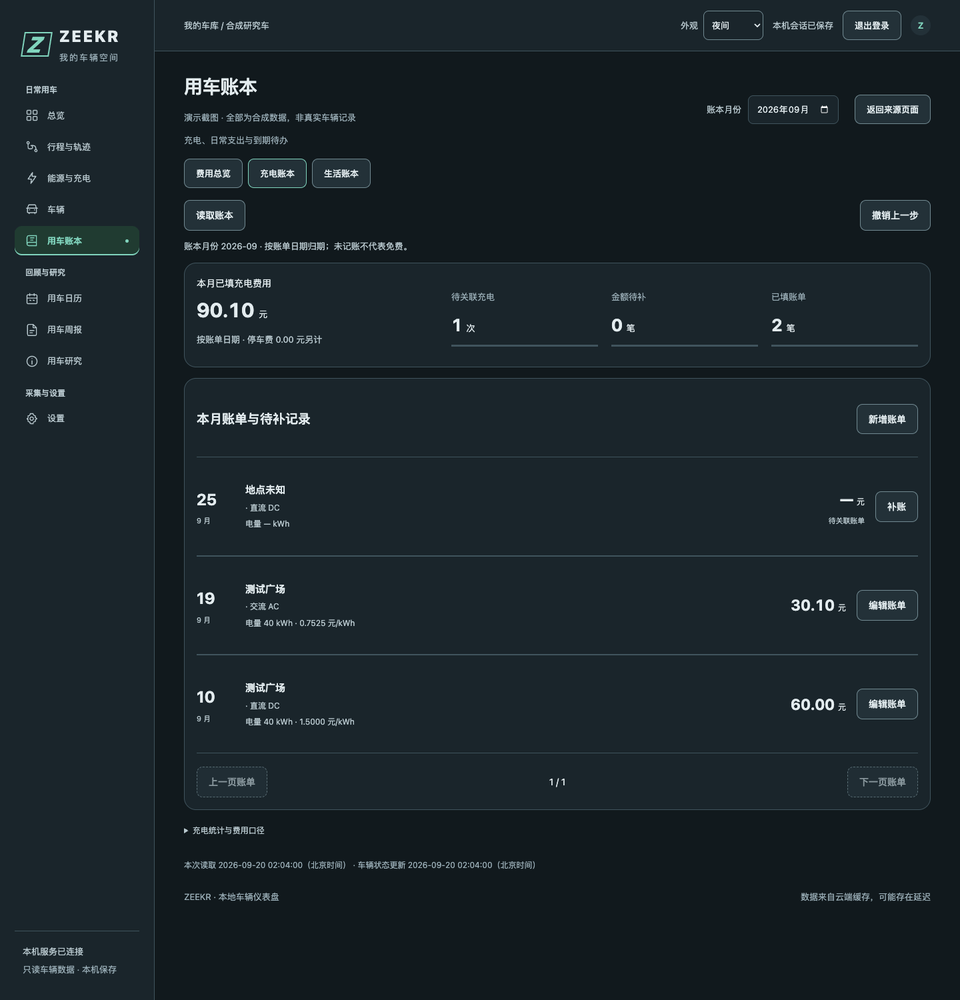
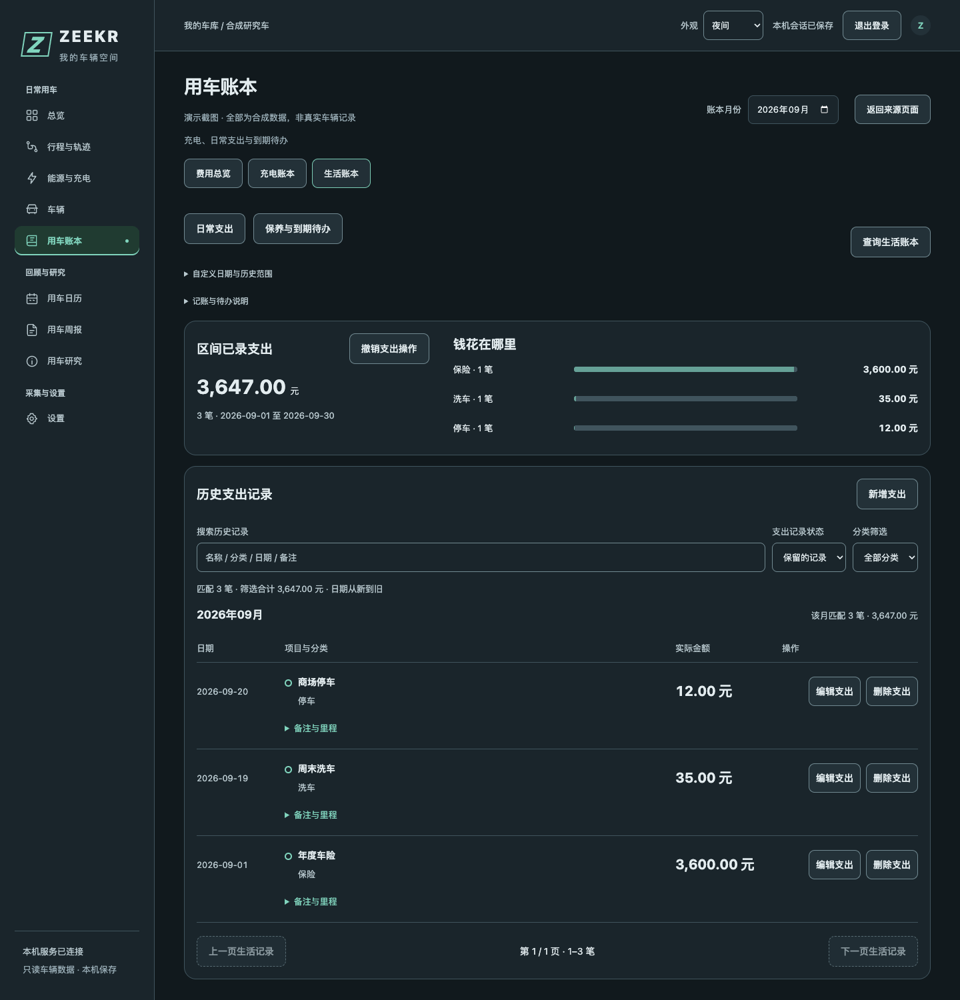
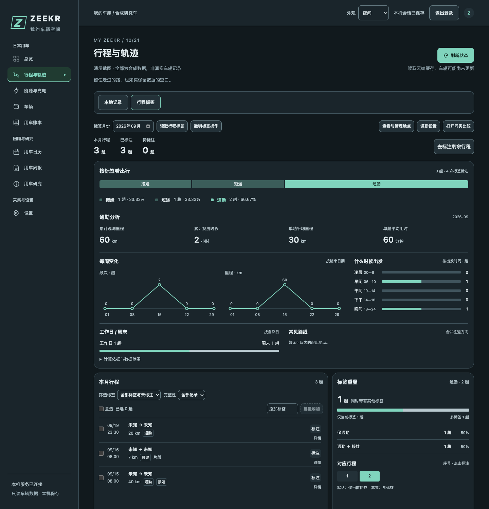

# Zeekr Control

面向中国区极氪车辆的只读命令行工具与桌面 Web 仪表盘。把分散的车辆缓存、行程、充电和费用记录整理成可回顾的用车数据，支持本地标签、地点校正与自动通知。已在一个老款 001 副账号上验证短信登录、分享车辆列表和 GW2 状态读取；其他车型、账号及接口兼容性需单独核验。

Python 运行期无第三方包依赖，已兼容 Python 3.9.6。项目不提供远程车控；车辆状态来自云端缓存，不代表实时状态。

## 功能

| 功能 | 当前支持与边界 |
| --- | --- |
| 总览 | 动力电池、预估续航、逐项门窗摘要、最近观测活动，以及最近完成行程和充电 |
| 车辆 | 逐项门窗、门锁、胎压、胎温、座舱温度与 PM2.5；未知状态明确保留，不以整车摘要代替单项结果 |
| 能源与充电 | 月度充电回顾、AC／DC 费用构成、同期费用、两次充电之间的综合电耗与百公里参考电费；支持站点确认、地点纠错、单次曲线和记录管理 |
| 行程与轨迹 | 连续出行链、24 小时出行节奏、常走路线汇总；逐趟标签、频次与占比、每周变化和地点管理；轨迹默认折叠，位置与地图按需加载 |
| 用车账本 | 本月／全部历史费用总览、月度与年度趋势；充电账本统一新增、补账、编辑、删除、恢复与撤销；生活账本提供分类金额图、支出流水和保养待办 |
| 用车日历与周报 | 按日期回看行程、充电及停车观测，汇总周期用车情况；补账跳转到充电账本，并可返回原页面 |
| 后台监控 | 自动发布最新快照、记录行程；Bark 发送行程、充电及自定义状态提醒，企业微信发送行程/充电详细报告、路线图和存储详情 |
| 参数字典 | 统一字段名称、单位、类型和参考依据；默认浏览，按需编辑人工核实记录 |
| 用车研究 | 参数研究与核实：待研究参数、观测变化、就地结论与高级取证 |
| 设置 | 连接与隐私、采样、本地存储及自定义提醒 |
| 账号与登录保护 | 设置页支持车辆副账号短信重连；Web 访问另有密码、记住设备、会话过期和失败限流，两类登录独立 |

界面与数据规则详见 [Web 使用说明](docs/web-usage.md)。合成测试通过不等于实车或所有车型验证通过。
当前只维护和验证桌面界面，产品规则见 [PRODUCT.md](PRODUCT.md)。

## 界面预览

以下均为当前桌面界面的**合成数据截图**，不含真实账号、车牌、VIN、行驶轨迹或充电地点；日期、金额和车辆读数均为演示值。截图未开启地图，也未连接车辆云端。

### 行程与轨迹

当天出行与出行节奏并排展示，地图和采样详情默认折叠。停车位置保留实测、推定和未知的区别。



### 能源与充电

按月回顾充电、电量与费用；缺失金额不按免费处理，电量来源与估算依据可以展开查看。



<details>
<summary>查看充电账本、生活账本与行程标签</summary>

### 充电账本

未关联充电、金额待补与已填账单分别统计，不拼成容易误解的完成百分比。从充电回顾或日历进入时，直接打开对应账单；跨月支付仍定位到原账单。



### 生活账本

按分类查看金额分布，点击横条筛选支出；保留新增、编辑、搜索、历史范围、删除恢复与保养待办。



### 行程标签

逐趟标注与按标签分析放在一起。分段条展示标签出现次数，图例展示各标签占全部行程的比例；一趟行程可有多个标签。



</details>

截图来源与重拍方法见 [截图说明](docs/images/README.md)。

## 快速开始

在 Mac 终端进入项目目录，使用已接受车辆分享的副账号登录：

```bash
cd /path/to/Zeekr
python3 -m zeekr_control login
```

手机号与短信验证码均隐藏输入。新登录可能使同一副账号的官方 App 会话下线；不要把验证码或 Token 发到聊天。

登录完成后，查看车辆并启动网页：

```bash
python3 -m zeekr_control vehicles
python3 -m zeekr_control status
python3 -m zeekr_control web
```

打开 [本机仪表盘](http://127.0.0.1:8765)，查看已有缓存；需要时点击“刷新状态”。车辆会话失效后，也可在“设置 → 连接与隐私 → 账号会话”重新连接副账号。默认仅监听 `127.0.0.1`；终端按 Ctrl+C 停止服务。需要其他端口时使用 `web --port 8766`。

Web 服务启动后默认开启统一后台采集，无需打开网页。后台成功读取车辆后写入私有最新快照，页面约每 5 秒读取本地状态，不因轮询新增车辆云端请求。服务重启后，相同会话和车辆可恢复最近快照及原车辆时间。

地图仍需主动开启。后台默认每 30 秒检查；设置可改为 10–60 秒整数，停车、行驶和充电保持所选间隔。更快查询不保证车辆上传更快，重复云端状态不会增加轨迹点。设置中的开始／暂停控制同一后台，暂停停止新的自动车辆检查和常规通知领取；已开始的发送保留结果，存储巡检及存储异常／恢复通知继续。关闭浏览器不会停止采集；服务退出或 Mac 休眠期间无法采集，服务重启后默认恢复，保留已保存的间隔。

## 标签与地点

- 行程支持手工标签、备注和批量标注；标签分析只使用已有记录，缺失值不当作零。
- 可把已保存地点绑定到标签，按出发、到达或任一端点自动识别；也可要求同一停车区间内存在充电记录。
- 新规则默认面向后续记录。处理旧行程需先预览影响，再明确应用；单趟可排除或恢复自动标签。
- 充电站点优先显示站名，其次显示地点名。人工地点校正不会修改原始 GPS，也不会把不可信定位变成可信定位。

## Web v2 数据规则

- `zeekr_control/parameter_dictionary.json` 是运行时术语来源；字段按完整路径匹配，避免动力电池与低压电池等重名项混淆。
- 连续数值的字段说明确认不会因 SOC、温度或里程读数变化失效；枚举仍按具体原值确认，新码保持未知。
- 四门四窗分别解释。一个位置未知时，其他位置的已知结果继续显示；整车摘要会注明已知与未知数量。
- `snapshots.sqlite3` 按会话摘要和车辆摘要隔离。更早或缺少车辆时间的响应不会覆盖已有较新快照；相同车辆时间允许内容修订并增加 revision。
- `/api/state` 只读本地存储和服务状态。手动“刷新状态”才请求车辆云端缓存，并继续受所选状态查询间隔、跨进程锁和 429 冷却保护。
- 本地事件摘要只输出时间、时长、里程、SOC、完整性及事件保存的电池容量；普通页面不返回通知正文、地址或精确坐标。

详细设计见 [Web v2 执行设计](docs/web-v2-design-2026-09-18.md)，使用说明见 [Web 使用说明](docs/web-usage.md)。

### 常用命令

```bash
# 多辆车时，按 vehicles 返回的序号选择
python3 -m zeekr_control status --vehicle 1

# 查看默认脱敏的原始状态
python3 -m zeekr_control status --json

# 隐藏输入已有 JWT，换取 GW2 会话
python3 -m zeekr_control login --token

# 查看全部命令
python3 -m zeekr_control --help

# 删除本机会话，不撤销云端令牌或删除轨迹数据库
python3 -m zeekr_control logout
```

`status` 默认输出中文摘要。动力电池使用专用字段，不以低压电池电量替代；缺失或非法数值显示未知。门锁、门窗及充电状态只解释本车已核对的组合，其余保留未知和原值。

需要在本机查看完整 VIN 或位置时，可用 `vehicles --full` 或 `status --json --full`；凭据字段仍隐藏。默认脱敏不能保证覆盖所有未知字段，分享输出前仍需检查。`login --token` 也可能影响同账号的其他会话。

## 车型资料与续航达成率

首次配置时复制通用模板，并填写自己的车型资料：

```bash
cp zeekr_control/vehicle_profiles.example.json zeekr_control/vehicle_profiles.json
```

`vehicle_profiles.json` 已被 Git 忽略。可配置车辆名称、年款、参考图片，以及 `range_km`、`range_standard`、`range_source`。标称标准支持 CLTC、WLTP、NEDC、EPA；模板不预填续航值。多车资料按车辆摘要分别匹配，未配置时显示通用名称。

实际续航达成率采用当前车辆最近一次已结束的后台行程：

```text
达成率 = 实际行驶里程 ÷（标称续航 × 消耗电量百分点 ÷ 100）× 100%
```

不使用当前剩余续航代替历史行程数据。不完整、跨充电、耗电为零或电量回升、标称值缺失等情况不计算，也不回退使用更早行程。该指标可能超过 100%，不代表电池健康。完整口径见 [能源与充电说明](docs/web-usage.md#能源与充电标称续航与实际行程达成率)。

## 自动行程与充电通知

统一后台默认每 30 秒检查缓存车辆状态，可在设置中改为 10–60 秒，停车保持同一间隔，并记录行程及充电事件。检测到可信行驶时，行程开始 Bark 提示只发送一次；检测到可信充电开始、结束时发送对应 Bark 提示。通知按内容分流：

- 行程开始：Bark 状态提醒。
- 开始充电：Bark 状态提醒。
- 充电结束：Bark 状态提醒；企业微信发送详细充电报告。
- 行程结束：Bark 状态提醒；企业微信发送详细行程报告和路线图片。
- 自定义提醒成立及恢复：优先 Bark；Bark 明确失败时由企业微信兜底。Bark 结果不确定时不兜底，避免重复通知。
- 存储异常及恢复：Bark 发送短提醒；企业微信发送完整详情。两通道独立记录和重试。

先按 [监控配置说明](docs/monitor-usage.md)保存企业微信私有 Webhook，并按 [Bark 通知说明](docs/bark-notifications-2026-09-21.md)保存 Bark 服务地址和设备 Key，再启动：

```bash
python3 -m zeekr_control monitor
```

在另一终端查看健康状态和最近通知：

```bash
python3 -m zeekr_control monitor-status
```

`web` 默认启用统一后台；已有 `monitor` 进程时共用它，没有时由 Web 启动同一后台逻辑。进程锁保证只有一个采集执行者。采集进程把事件写入持久队列，受监督的独立投递进程发送通知。网页“暂停采集”停止新查询和常规通知领取，已开始的发送仍保存结果；存储巡检及其通知继续，周期报告使用独立开关。开始后恢复；服务重启默认开启。网页手动刷新只更新页面，不额外写轨迹。多车首次绑定使用 `monitor --vehicle 1`。`monitor --once` 会查询车辆一次，并在 30 秒领取预算内处理到期通知；已开始的任务有界结束，剩余任务保留。它不是无副作用的测试模式。

普通停车的行程结束需明确下电后确认十分钟；若已冻结下电停车点，且随后连续可信状态确认原地开始充电，则立即结算到站行程，充电后再次行驶另记一段。首次下电端点冻结后，特定同一停车缓存可按连续本机观测完成普通停车确认，但不增加报告样本或刷新停车状态时间。充电状态按已核验活动/停止组合判断；停止不等于拔枪、达到目标或已知停止原因。云端延迟会影响通知时间，实车行驶及充电场景仍需分别验收。

## 查询保护与数据存储

CLI、Web 和后台采集复用本机跨进程请求锁，同一私有目录最多一个网关请求执行。同账号车辆状态请求按所选采样间隔保护（默认 30 秒，可调 10–60 秒），失败也计入间隔；不同车辆不能绕过限制。状态响应缓存使用同一间隔，车辆列表成功响应缓存 60 秒；命中缓存不会伪造新的云端读取时间。间隔保存在私有目录的 sampling.json；CLI、Web 和后台按各自会话所在目录读取同一配置及查询锁。10 秒是项目配置下限，不是已验证的官方额度。

HTTP 429 根据 `Retry-After` 建立共享冷却，无有效响应头时暂停 60 秒。请求层不自动重试；独立监控的后续轮询与通知重试规则见监控说明。网络超时为 20 秒，并发锁最多等待约 25 秒，失败时不绕过保护。这些是本项目的保护配置，不是极氪官方公布的额度。

默认数据目录为 `~/Library/Application Support/ZeekrControl`，目录权限 700，私有文件权限 600：

| 文件 | 内容 |
| --- | --- |
| `session.json` | 车辆状态会话与已有私有配置 |
| `queries.sqlite3` | 短期查询缓存，可能包含车辆身份与位置 |
| `tracks.sqlite3` | 本地轨迹、后台行程和通知记录 |
| `snapshots.sqlite3` | 私有车辆快照与历史归档，按已验证的账号、会话和车辆关系隔离 |
| `personal.sqlite3` | 人工账单、生活支出、行程标签、地点校正及自动标注规则 |
| `field-reviews.sqlite3` | 本车字段及具体原值的人工核实记录 |
| `wecom-webhook.json` | 单独配置的企业微信群机器人 Webhook |
| `bark.json` | Bark HTTPS 服务地址和设备 Key；用于 Apple 设备状态提醒 |
| `auth-failure-alert.json` | GW2 `1509` 采集中断的 Bark 一次性告警状态；成功采集后重置 |
| `amap-geocoding.json` | 可选的高德 Web 服务 Key，用于通知发送前解析地址并生成真实静态地图 |

这些文件受权限保护，但属于本机明文存储，不是加密保险箱。登录不保存手机号、短信验证码或 JWT；默认不捕获刷新 Token。明确选择 macOS 钥匙串后，refreshToken 仅存本机用户钥匙串，session／候选文件只留引用，现有 accessToken 仍保留在 600 权限的兼容会话文件。钥匙串不可用时不回退明文。自动续期默认关闭，需单次真实验证与明确启用；未知结果禁止重放。见 [钥匙串连接与续期](docs/macos-keychain-refresh.md)。`logout` 只删除活动会话，不云端撤销 Token、不物理擦除旧钥匙串项目、缓存或轨迹。轨迹默认长期保留，不自动删除。

仓库不包含真实账号凭据、个人车型配置、实车快照或数据库。定位底图使用高德地图，只有开启位置显示后才加载相应区域瓦片。更多说明见 [隐私边界](docs/privacy.md)与 [第三方资源声明](THIRD_PARTY_NOTICES.md)。

## 服务器部署与 Web 登录

Mac mini 常驻部署使用 launchd + Tailscale Serve，开发、登录代理与固定发布步骤见 [macOS 开发与发布](docs/macos-development.md)。下方 systemd 模板用于 Linux。

提供独立 Web、监控 systemd 服务和 Nginx 模板，见 [服务器部署说明](docs/server-deployment.md)。部署模板使用回环监听与独立服务用户，可通过 SSH 隧道访问。

Web 密码登录通过 `ZEEKR_AUTH_FILE` 指定密码哈希文件；已指定但配置无效时启动失败。未设置时仍是本机开发模式，不得直接公开。HTTPS 域名入口还需设置 `ZEEKR_PUBLIC_ORIGIN` 并配置反向代理和证书。Web 登录与极氪账号登录是两套会话。

登录时可选“不记住”、记住此设备 7 天或 30 天。记住凭证绑定此浏览器 Cookie、浏览器标识和服务端可确认的 IP，期限从登录时固定计算；到期、退出、更改密码或绑定信息不同后需重新输入密码。凭证哈希存于私有数据目录的 `web-remembered.sqlite3`，随数据保留可跨 Web 重启。公网代理的 IP 配置及 SSH 隧道限制见部署说明。

更新 Python 后端后需重启相应服务加载代码；Git push 本身不会完成服务器部署。未选择记住设备的 12 小时网页登录会话在重启后失效，统一采集默认恢复。

## 故障处理

| 提示或现象 | 处理方式 |
| --- | --- |
| `尚未登录`、车辆状态会话失效 | 在网页设置页重新连接车辆账号，或在运行服务的机器上执行 `login` |
| 车辆列表为空 | 核对副账号是否已接受车辆分享，以及所选账号 |
| 刷新成功但状态没变化 | 检查车辆状态时间；`latest=Local` 读取云端缓存，不主动唤醒车辆 |
| 本地历史缺少记录 | 核对采集时间、服务运行与归档覆盖；已移除厂商云端历史导入，不会自动补齐未采集时段 |
| HTTP 429 或本机查询冷却 | 等待提示时间后再试，不连续刷新 |
| 路线没有显示 | 核对是否已开启位置显示、是否存在采样点，以及坐标系是否支持 |

排查时可记录命令名和网关代码；不要分享 Token、完整 VIN 或原始抓包。

## 开发验证

详细安装和分组测试见 [开发验证](docs/development.md)。Python 运行期无第三方依赖，浏览器测试依赖由 npm 锁定：

```bash
npm ci
npm run browser:install
npm test # unit + smoke + review
```

统一入口强制桌面覆盖，使用合成账号与临时数据；不访问真实车辆。按改动选择相关测试，发布时按 [发布流程](docs/release-workflow.md) 验证最终候选。

## 文档

- [当前产品约定](PRODUCT.md)：桌面范围、数据与费用口径、通知和验收边界。
- [当前实现入口](DESIGN.md)：采集与投递、只读分析、工具加载及缓存。
- [开发验证](docs/development.md)：依赖安装、桌面分组与本地交接。
- [Web 使用说明](docs/web-usage.md)：页面、定位、采集、历史与能源口径。
- [Web v2 执行设计](docs/web-v2-design-2026-09-18.md)：桌面信息架构、快照、事件摘要和验收矩阵。
- [车辆参数字典](docs/vehicle-parameter-dictionary-2026-09-18.md)：字段术语、单位、依据和适用性说明。
- [自动监控说明](docs/monitor-usage.md)：后台配置、通知及实车验证边界。
- [Bark 通知说明](docs/bark-notifications-2026-09-21.md)：Bark 与企业微信的通道分工、私密配置和验收方法。
- [服务器部署](docs/server-deployment.md)：服务隔离、登录保护及回滚。
- [API 调研](docs/api-notes.md)：协议来源、已验证字段与未验证接口。
- [设计说明](docs/design.md)：初始架构与约束。
- [隐私边界](docs/privacy.md)：本机配置、敏感数据与仓库范围。
