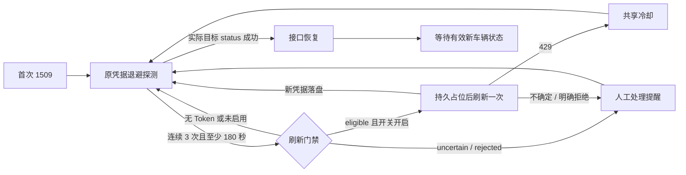

# 1509 自动续期与行驶数据保全：具体设计

日期：2026-10-23。状态：**核心及钥匙串接线完成；首次刷新、单独授权的受控复用、两次目标车辆实际读取通过。复用只在已证实成功＋新会话实际读取后生效，未知／拒绝仍禁重放。活动版本及开关另核对发布回执。**

配套执行清单：[实施计划](../plans/2026-10-23-1509-refresh-recovery.md)。

## 1. 基线与目标

实现起点：工作树 HEAD 和 Mac mini 活动发布均为 `4428200b548a92b636fd60fc0e49ddec2c779d8a`。该发布已具备 1509 退避、自愈、脱敏原因、片段及轨迹断点保护，但没有 refresh 操作或持久保存 refreshToken。本轮只改本地工作树，未改服务、账号、运行配置或真实数据。

目标：先用原凭据恢复读取；必要时只允许一个凭据交换请求执行；保住已返回的里程、电量、速度、充电及行程观测。定位缺失不阻断这些数据落盘。未收到的历史状态不补造。

不把 1509 定义为永久失效，不假定 refreshToken 必定下发、必定轮换或可重复使用。保留 `session_scope` 的凭据版本语义和 `account_scope` 的稳定账号归属。

设计接受 v3.1 的全部约束，并补齐：活跃占位识别、禁重放与人工重登分离、按 refreshToken 本身记状态、会话已写入但完成标记未写入的恢复。

## 2. 具体选择与启用条件

| 项目 | 本设计选择 |
| --- | --- |
| 协调方式 | 持久占位；短文件锁仅保护本地领取、核对、提交、恢复；网络期间不持文件锁 |
| 查询保护 | 继续使用同一 `QueryPolicy`；禁止另建无保护的 refresh 传输路径 |
| 初始刷新阈值 | 建议连续 3 次实际 1509 且从首次失败起至少 180 秒；未经实证校准，属于初始配置而非根因结论 |
| 原凭据重试 | 保留 60、120、240、300 秒退避；实际 429 冷却优先 |
| 默认开关 | `auto_refresh_enabled=false`；无 refreshToken 时保持现有采集能力 |
| 历史关联 | 用冻结账号成员选择器及索引关联替代每个 scope 一段 `UNION ALL`，不删除旧关联 |
| Token 存储 | `CredentialStore` 接口隔离；文件／钥匙串由用户选定，本稿不代选 |
| 真实验证 | 另行授权后短信登录捕获可选字段、单次刷新、用新凭据读目标车辆；不测试旧 refreshToken 复用 |

阈值满足并不等于允许刷新。还必须同时满足：功能已获准启用、账号和绑定车辆明确、存储可用、该 refreshToken 为 `eligible`、没有活跃凭据操作、查询策略允许请求。

## 3. 模块及接口

以下为设计职责；实际已实现接口、精简字段及启用留白见末节：

| 模块 | 职责／接口 |
| --- | --- |
| 新 `credential_coordinator.py` | `reserve(kind, expected_scope, refresh_fp=None)`、`finish(op_id, result)`、`reconcile()`；统一协调全部凭据交换和退出 |
| 新 `credential_store.py` | `read_active()`、`stage(op_id, candidate)`、`validate_staged(ref)`、`activate(ref)`；隐藏 Token 存储差异 |
| 新 `collection_incidents.py` | 记录 1509 事件、实际状态请求结果、恢复时刻和分类变迁；不拥有刷新资格 |
| `client.py` | 新增独立 `gw2_refresh` PUT 操作，返回候选凭据；自身不写活动会话、不自动递归重试 |
| `errors.py` | 区分查询保护阻止发送、429、明确拒绝、结果不确定；不根据错误字符串推测发送与否 |
| `monitor_runtime.py` | 驱动双状态机；调度原凭据探测／符合条件的刷新；沿用原始快照、行程片段和断点逻辑 |
| `vehicle_login.py`、`cli.py` | 短信／JWT 的凭据交换及 logout 接入协调器；短信挑战和验证码校验仍在内存 |
| `system_notifications.py` | 增加事件编号与模板类型的持久投递关联，继续由投递进程发送 |
| `snapshots.py`、`archive_reader.py`、`web.py` | 新历史成员选择器及查询版本指纹，消除 256 和 compound SELECT 限制 |

`reserve()` 返回明确的 `owned / busy / superseded / disallowed / unavailable` 之一。调用者只能在 `owned` 时进入凭据交换。`busy` 不阻止受查询策略保护的只读采集。

## 4. 状态、文件和权限

计划新增于现有私有应用数据目录，不放入 Git 或公共发布输入：

| 文件 | 内容 |
| --- | --- |
| `connection-policy.json` | 非秘密配置；初始关闭自动刷新，存储 provider 未选定 |
| `credential-coordination.lock` | 本地短临界区文件锁，600、当前用户、拒绝符号链接 |
| `credential-coordination.sqlite3` | 操作意图、Token 指纹状态、提交回执；不含 Token 值 |
| `collection-incidents.sqlite3` | 独立的采集中断事件、探测与通知关联；不含 Token、VIN、位置 |
| `credential-staging/` | 提交中候选，700；文件模式下候选含凭据、文件 600；钥匙串模式只含原有读凭据与秘密引用，不将 refreshToken 写到这里 |

数据目录维持 700。连接显式启用完整同步；意图在网络前提交。候选和活动指针采用受限临时文件、文件同步、原子替换及目录同步；失败不报告“已持久提交”。不能把未提交的 SQLite 事务当作崩溃恢复依据。

`connection-policy.json` 使用可由现有安全字符串存储读取的字段：`schema_version="1"`、`auto_refresh_enabled="false"`、`refresh_after_failures="3"`、`refresh_after_seconds="180"`、`token_provider="unselected"`、`validated_contract_id=""`。缺失、未知版本或无效配置时禁止自动刷新，但保持原凭据读取；还需显式注入已选定的 refresh-capable provider，仅改配置不够。首次真实验证记录对应 validated_contract_id；旧 Token 复用规则另行授权，当前没有自动复用开关。未来改变 provider／启用开关前须确认没有活动凭据操作，不能在一个进行中的提交里更换 provider。

两个状态库分别迁移。刷新协调库损坏时禁止凭据变更，但在能安全读取旧会话时仍允许原凭据采集；中断统计库故障不使已经收到的驾驶快照被丢弃。原始数据落盘故障继续遵守现有失败处理，不伪报成功。

### 4.1 凭据指纹与状态

`refresh_fp = SHA256(domain_separator || account_scope || refreshToken)`，只在服务端私有协调库中使用。不得公开到健康接口或通知。不能用整个 `session_scope` 代替它。

每个 refresh_fp 保存：`owner_key`、`state`、`may_refresh`、最后操作编号和不含秘密的原因。状态为：

| 状态 | 自动刷新资格 |
| --- | --- |
| `unavailable` | 无 Token 或存储／协议未启用，不可刷新 |
| `eligible` | 尚未使用的新 Token，且其他门禁满足时可领取 |
| `executing` | 只允许当前占位执行者继续 |
| `completed` | 旧 Token 已完成一次使用；本次成功本身不证明可再次使用 |
| `uncertain` | 禁重放，跨采集恢复和重启保留 |
| `rejected` | 禁重放，保留原 accessToken 探测 |

返回不同的新 refreshToken：旧 fp 标 `completed`，新 fp 可成为 `eligible`。未返回或返回相同 refreshToken：保存可用的新 accessToken，但该 refresh_fp 不自动重新变成 `eligible`；除非对应复用规则已单独获准实测确认。

重新认证也必须核对实际拿到的 refresh_fp；若与已禁用的旧值相同，不得仅因短信登录成功而清掉禁重放记录。新会话未带 refreshToken 时，可以采集，但自动刷新为 `unavailable`。

### 4.2 操作表

`credential_operations` 的最小字段：

```text
op_id, kind(refresh/sms_login/jwt_login/logout), active_slot,
phase(reserved/dispatch_planned/prepared/activating/committed/
      not_sent/rate_limited/uncertain/rejected/superseded),
baseline_scope, refresh_fp, owner_pid, owner_process_birth, owner_boot_id,
claimed_at, deadline_at, candidate_ref, expected_scope, committed_at,
safe_error_code, safe_error_reason
```

`active_slot` 取 1 或 NULL，并设唯一约束：最多一个未结束的凭据操作；终态释放执行占位，但 refresh_fp 的禁重放状态仍保留。`op_id` 为随机操作标识，作为提交栅栏。

PID、进程出生标识与系统启动标识共同判断所有者。执行者仍存活时，即使另一个进程启动或期限到达，也只能等待／跳过。无法判断是否存活则保持 busy 并报告待检查，不凭超时抢占。确认执行者已退出后才处理遗留记录；期限只用于诊断，不授予新的刷新资格。

## 5. 凭据交换协议

1. 在短文件锁内安全重读活动会话，核对预期 `session_scope`、账号、操作资格与活跃占位。scope 已变则返回 `superseded`，重新使用当前会话探测，不接着刷新新会话。
2. 生成 op_id，写入并提交占位与 `dispatch_planned` 意图，标记 refresh_fp executing，然后释放文件锁。此时崩溃即保守按不确定处理，除非有持久证据证明未发送。
3. 调用 `Client.refresh_gw2()`，由原 QueryPolicy 控制网络。查询锁期间不访问协调文件锁；客户端只返回结构化结果和候选数据，不写 session.json。
4. QueryPolicy 返回并释放查询锁后，再取得短文件锁。核对 op_id、所有者、phase 与基线；不符合则不覆盖当前会话。不得回退覆盖他人已完成的新凭据。
5. 成功响应先校验字段类型、已返回 userId 的一致性及本地绑定基线。身份矛盾或不完整成功响应按未知结果处理，不发布为活动凭据。缺失可选 userId/clientId 时保留经过验证的原值，不能用空值抹掉。refresh 沿用基线 deviceId，不生成随机新设备。此短临界区不发验证请求；需要的车辆网络验证另经 QueryPolicy 执行，随后重新领取短锁核对版本。
6. 按选定 provider 安全保存不可变候选。提交 `prepared` 回执：candidate_ref、预期新 scope、旧 refresh_fp、候选身份校验结果。回执不含秘密值。
7. 原子激活候选，再记录 committed、旧 refresh_fp 的结果、新 fp 的资格，释放执行占位。刷新完成时刻在这里记录；此时不宣布采集恢复。
8. 后续目标 status 请求仍遵守共享冷却与正常间隔。成功后按第 8 节记录恢复。

存储层为每次真正激活的凭据版本提供一个非秘密 `credential_revision` 字符串；文件模式可保存可选 refreshToken，钥匙串模式保存秘密引用。两者都令原 `session_scope(session)` 继续反映全部凭据版本变化，包括只变 refreshToken 的情况。不得把真实 Token 写进协调或中断库。

### 5.1 失败分类

| 结果 | 会话／刷新状态／后续 |
| --- | --- |
| QueryPolicy 明确未调用传输 | 结构化 `RequestDeferred(request_sent=false)`；关闭本次占位，Token 不算已使用，等待原期限 |
| 实际 429 | 保留会话和服务器冷却，记录 rate_limited，不伪计为凭据失效；不绕过保护再刷 |
| 已验证协议中的明确拒绝 | rejected，结束执行占位，排队一次人工处理提醒；保留 accessToken 低频探测 |
| 超时、5xx、响应丢失、无效 JSON、含糊的业务码 | uncertain；结束占位并保留禁重放；只继续安全的读取，不自动重发 refresh |
| 成功响应但候选／活动提交失败 | 存储故障，保留日志和候选，走本地恢复，不再次请求 refresh |
| 当前会话已被外部路径改变 | superseded；不覆盖、不再刷新旧值，核对当前会话 |

明确拒绝的业务码必须有验证依据，不从 1509、包含 token 的文字或任意 403 推导。首次实现对未知错误保守归为不确定；人工处理提醒也不能宣称已证明 Token 永久失效。

## 6. 崩溃恢复与人工操作

启动、领取操作前执行 `reconcile()`。恢复不发网关请求：

| 崩溃位置／证据 | 恢复动作 |
| --- | --- |
| 无意图 | 正常执行已有状态，不创造中断 |
| 意图存在、所有者仍活跃 | 不接管，不改变 Token 状态 |
| 所有者退出、无可靠候选 | 原 refresh_fp 置 uncertain，结束执行占位；允许后续人工重登／退出 |
| prepared 候选完整、活动仍为基线 | 重新验证 provider 中候选及身份，可只做本地提交，不重发 refresh |
| 活动 scope 等于已记录 expected_scope、完成标记缺失 | 验证所引用秘密存在，补 committed；不把已经落盘的新凭据误认成旧 Token |
| 活动既非基线也非 expected_scope | 保留活动会话，旧操作 superseded，禁止回写旧候选 |
| 读取或验证证据不足 | 保持需人工核对，不宣称完成；原 accessToken 若可安全读取则继续探测 |

短信发码不领取长期占位；验证码输入时也不占位。发码时可以捕获基线，真正交换验证码前再领取执行权并重读基线；若刷新已更换会话，则取消该旧挑战而不消费验证码交换请求。网页和 CLI 使用同一规则。

logout 不发网络请求，但参与同一协调：存在活跃交换时返回 busy，不强删／复活会话；无活跃交换时在短临界区删除活动会话并保留审计和禁重放记录。CLI 的人工交互仍不接受通过命令参数传 Token。

## 7. monitor 调度与通知

每轮先保存已有成功返回的数据；仅在当前账号、车辆、会话版本核对通过后推动对应行程和提醒。不能用旧会话的迟到结果改变新账号活动状态。

1509 状态主线：



无 refreshToken／未启用时，保留现有持续 10 分钟且至少 3 次失败的中断提醒。符合刷新阈值但该 Token 已 uncertain/rejected 时，排队该事件的一次人工处理提醒；不要再发 refresh。原凭据读通只关闭采集中断，不更改禁重放标记。

通知使用 `(incident_id, kind)` 去重。采集进程只记录投递意图，投递进程发送。复用 sending/uncertain 防重逻辑；保留既有 sent 记录，不因迁移重发旧提醒。业务行程、充电、资源告警范围不扩张。

## 8. 采集中断记录与恢复判据

`collection_incidents` 最小字段：

```text
incident_id, owner_key, vehicle_key, opened_at, first_1509_at,
last_successful_status_fetch_at, baseline_vehicle_state_at,
collection_phase, classification, last_probe_at, probe_count,
refresh_completed_at, interface_recovered_at, fresh_state_seen_at,
fresh_vehicle_state_at, recovery_method, closed_at,
fresh_state_outcome, superseded_by_incident_id
```

另有追加式 `incident_transitions` 与 `incident_probes`，记录类型、时间、凭据版本指纹、是否实际请求、是否命中缓存、脱敏错误；只读投影不返回内部指纹、PID、秘密引用或位置。

三个时刻独立：

- 刷新完成：候选凭据已持久激活且提交可确认。
- 接口恢复：目标车辆 status 确实发出网络请求，返回允许的成功码且具有有效车辆状态结构。列表／登录成功或本机缓存命中不算。需要 `QueryOutcome` 显式提供 operation、actual_request、cache_hit、fetched_at、success_code、schema_valid，不靠最后一条错误文字判断。
- 有效新状态出现：车辆时间超过中断前基线，符合现有非未来／有效性／新鲜度检查，且实际成功保存；定位不作为必要条件。单纯较旧缓存时间推进不能证明实时覆盖。

接口恢复即结束这次接口中断并记录时长；有效新状态可以尚未出现，停车车辆继续正常等待。若等待期间又发生新的中断，开启新事件，旧事件标记 `not_observed_before_next_outage`，不拿下一次事件的数据伪造旧时段覆盖。

记录采集状态与刷新凭据状态的不同迁移：旧 accessToken 成功可以令接口事件关闭，但 uncertain/rejected 指纹永久保留到明确解除条件。健康文件只保存无秘密的标量投影，不作为操作单飞的权威存储。

现有最近 200 条 gateway_failures 保持诊断用途。不得反向构造不存在的成功记录、精确时长或自愈比例；旧事件只有能证明的边界，缺失部分保持未知。

## 9. 256 历史关联：具体替代方案

现有 `archive_aliases()` 最多取 257 条后报错；`ArchiveReader._scoped_connect()` 再按每个 alias 拼 `UNION ALL`。单纯提高上限仍扩大 SQL，可能撞 compound SELECT 限制。本设计不走此路线。

新增不可变 `ArchiveScopeSelection`：`current_scope`、经当前 scope/vehicle 关系核实的 `owner_key`、`vehicle_key`、账号关联表的冻结 rowid 上界、注册库文件身份。`account_scope` 和历史原始记录的 scope 均不重写。

每个归档分片连接附加经权限和路径核对的 `snapshots.sqlite3` 只读 URI，用固定大小的 TEMP VIEW 查询：`main.reads` 与只读 `archive_accounts` 按 scope/vehicle 索引关联，并限定 owner、vehicle 及冻结 rowid 上界。视图仍将结果的 scope 投影为当前 scope，保持现有消费者约定；每条原始 read 的 id/digest/时间不变。

不再枚举 N 段 UNION，不生成随 N 增长的 IN 参数，不删除关联、不迁移原始 payload。无可验证账号关联时退回精确 session scope，不能仅凭同 VIN 合并其他账号。

`ArchiveReader.frozen()` 一次捕获成员上界和现有分片 read-id 水位，随后多个日期块共用；查询中新增 scope 留到下次。关联表保持追加语义，原 scope 不得改属其他账号。注册库替换、作用域或归属异常时明确中止，不能返回看似完整的部分历史。

`web._analysis_revisions()` 改用选择器版本摘要，不再构造完整 alias tuple。时间范围、分页、raw read、冻结查询都必须走同一选择器，不能部分接口仍保留 256 限制。

必须通过 256、257、1024 个 scope，跨月份、相同时间多行、同车不同账号、查询中新增关联、注册库替换、无关联旧数据等测试。核对 SQL 查询计划使用索引和结果全集，不只断言接口“不报错”。旧读法仍可处理原始 scope，回退不依赖删数据。

## 10. Token provider 与启用留白

接口约定：provider 可安全读取活动 Token、按 op_id 保存不可变候选、验证秘密引用、激活候选。秘密的值只在必要内存与用户选定的秘密存储中存在；SQLite 意图、gateway_failures、日志、健康状态及投递正文都不保存值。

文件选项：refreshToken 与读凭据位于受限 session.json／同等权限候选，明确为本机明文；更新既有 README 隐私声明及备份处理说明后方可采用。

钥匙串选项：session.json 保存非秘密引用与 credential_revision，refreshToken 值留在钥匙串；通过非交互原生接口访问，不能把秘密作为 shell 参数。锁定／权限不足时返回 unavailable，不弹交互框卡住后台，不退回明文。验收覆盖实际 LaunchAgent 用户的登录后和钥匙串不可用场景。

选择存储之前可以实现协调协议、模拟 provider 和合成回归，但不能捕获／持久保存真实 refreshToken。

## 11. 测试与发布闸门

实现顺序与测试见配套计划。自动 refresh 开关必须保持关闭，直到以下条件全部成立：

1. 用户确认存储和真实验证时机；可选 refreshToken 捕获与缺失兼容均通过。
2. 单飞、进程身份、双状态、崩溃提交恢复和所有写会话路径回归通过。
3. 257/1024 作用域历史完整性通过，不能以截断或删除代替。
4. 单次真实 refresh 及新凭据读取成功；保存的凭据与提交回执匹配。若未获得不同的新 refreshToken且没有复用规则实证，不把旧值重新启用。
5. 用最终提交的生产匹配候选完成服务用户全量测试及必要桌面检查，四项精确提交 CI 全绿，仍经固定 macOS 发布入口备份、切换、验证。

新功能默认关闭和保留原始 session 字段，使旧读程序仍可运行；回退旧程序不会理解协调占位协议，因此存在执行中／未完成凭据操作时不得直接切回旧写会话代码。须先结束或恢复本地提交、确认无活动执行者，再停服回退。回退不恢复旧 Token、不用旧数据库覆盖新行驶数据。钥匙串 provider 回退前须验证旧程序所需读字段仍在 session.json。

## 12. 本地实现记录（2026-10-23）

本节区分已落地代码与前文设计目标；没有生产生效含义。

- 已实现 `QueryOutcome`、独立 PUT `gw2_refresh`、结构化 `RequestDeferred`。可选登录字段仅在显式 capture 时进入内存属性，默认 session 不含 refreshToken。刷新返回独立候选，不修改调用方会话；请求响应不进入查询缓存。
- `CredentialCoordinator.reserve()` 成功返回随机 op_id；busy／基线变化／禁重放通过 `CredentialBusy` 安全拒绝，不使用第 3 节设想的枚举返回。操作表实际字段为 `op_id,kind,phase,active_slot,baseline,refresh_fp,owner,claimed,expected`；owner JSON 包含 PID、出生和 boot 标识。候选引用由 op_id 推导，凭据版本由 expected 指纹核对。`refresh_states(fingerprint,state)` 独立于采集事件；账号已纳入指纹，不重复存储秘密。
- 意图在网络前提交。短文件锁与查询锁用上下文断言禁止嵌套；网络期间只持原有查询保护。确认死执行者且无完整候选时置 uncertain；prepared／活动已替换两种崩溃窗口只恢复本地提交。存活或身份未知不抢占；身份检查超时安全拒绝。
- 网页短信交换、CLI SMS/JWT/logout 均接入同一占位；短信挑战等待期间不占位。原同账号与绑定车辆验证保留，CLI 也在保存前核对。生产默认文件 store 只处理原读凭据；允许 refresh 的文件 store 仅在临时合成测试显式注入。
- `RefreshDriver` 默认关闭，即使独立使用，默认客户端仍带 QueryPolicy。阈值为至少 3 次实际 1509、至少 180 秒；未启用时沿用现行原凭据退避。HTTP 401 明确拒绝进入人工提醒；未实证的业务错误码保守归 uncertain，未擅自列为永久失效。429 与可证明未发送分别结束占位并保留资格；网络未知结果持久禁重放。
- 独立中断库实际表为 `incidents` 和追加 `probes`。`incidents` 保存 owner/vehicle、初始 scope、开始／末次 1509、1509 次数、基线与旧健康读取时间、三类恢复时间、当前分类和新状态结果；`probes` 记录各次 1509 的版本、目标 status 读通和刷新分类变迁。阶段字段、恢复方式和时长由这些记录推导，不伪造旧版本没有的历史成功记录。这里的 attempts 明确只计 1509，不代表所有网络请求总数。
- 采集先保存已成功返回的原始快照与行驶数据，再记中断恢复；统计库故障仅投影 `incident_recording=unavailable`，不丢快照。新健康标量为 refresh_status／incident_recording，不公开凭据指纹、PID、VIN 或秘密引用。现有 GPS 缺失与 gap 保护保持。
- 人工／普通中断提醒按 `(incident_id,kind)` 持久去重，旧 sending/uncertain 不重新投递。实际目标 status 请求成功且结构有效才关闭接口中断；缓存或车辆列表成功不关闭。旧 accessToken 自愈不改 refresh 状态。
- 历史查询已改用固定大小 `ArchiveScopeSelection` 与只读账号索引关联，不再枚举 UNION 或限制 256 个 scope。旧分片缺新索引仍可正确读取；`SnapshotArchive.ensure_read_indexes()` 是显式维护入口，只加索引，不修改 payload/read。实际历史库未运行维护；未来启用前按备份与维护窗口评估旧分片建索引。

验证记录：本机合成全量 `python3 -m unittest discover -s tests`，1522 项通过，97.873 秒。随后补进程身份异常、刷新秘密缓存隔离、默认查询保护和剩余 status 间隔回归；相关模块专项 178 项通过，最终变更相关专项 73 项通过。`git diff --check` 通过。最后专项包含真实 spawn 子进程竞争及强制退出测试，网关均为合成传输。一次从 stdin 启动的自定义 runner 不支持 spawn，另一次模块名单含不存在的测试名；改用正常 `python -m unittest` 模块入口后通过，不将这两次命令错误记作产品缺陷或通过证据。

仍待 T7：用户选择真实 Token 存储、正式 provider 接线、隐私及备份说明、实际 LaunchAgent 权限验证、一次真实刷新和新凭据读车；不试旧 refreshToken 复用。仍待 T8：精确提交候选的发布验收、CI、commit/push/deploy 授权。此轮未捕获或持久保存真实 refreshToken、未调用真实 refresh/SMS、未发送测试 Bark、未切换生产。

## 13. 钥匙串正式接线与首次真实验证

用户随后明确选择 macOS 钥匙串并授权一次真实刷新、读车、测试后提交发布及 push。已增加 `macos_keychain.py`、`keychain_store.py`、`connection_setup.py`；网页和 CLI 按明确 provider 捕获可选字段，所有提交仍走原协调器。选定钥匙串后，没有明文刷新 Token 的 fallback；存储配置异常拒绝交换，但不妨碍构造只读采集。

Keychain provider 将真实 refreshToken 留在 login 钥匙串，session／暂存候选只含引用和指纹。短锁内只调用原生本地非交互 API；查询锁与凭据锁仍不嵌套。服务 HOME 为独立 state，实测默认钥匙串搜索列表返回项目不存在；改按 uid 的真实用户目录显式打开 login.keychain-db，限定搜索范围后，真实临时 LaunchAgent 读取通过，原任务未因该检查重启。

本机人工短信认证成功，refreshToken 已下发并安全存储。按协议发出一次真实 PUT，成功返回且落盘；目标绑定车辆的实际 status 网络请求成功、结构有效，未把缓存或车辆列表当恢复。车辆状态时间另存，不能据此宣称实时车辆数据或历史缺口补齐。

此次未取得不同的新 refreshToken（不能再推断是未返回还是返回相同值）。同一指纹保持 completed；尚未实证复用规则，不自动重放或循环刷新。当前 connection-policy 自动开关仍 false。一次性验证意图先持久保存；若已有成功提交，只允许恢复 status 读取，重复执行入口不会再次发 refresh。隐私和备份边界见 [钥匙串说明](../../macos-keychain-refresh.md)。

相关专项覆盖引用作用域、指纹、锁定／缺项目不回退、候选失败、崩溃本地恢复、同 Token 禁重放、实际 status 门禁和配置异常只读存活。原生桥接测试不锁定真实用户钥匙串、不读取其他项目。发布仍须执行 T8 的精确候选全量、CI、备份与切换；自动循环续期的复用决策不由这次发布隐式授予。

### 13.1 另行授权的单次复用试验

用户明确选择“授权一次受控复用试验，核实能否连续自动续期”。新增一次授权表／实测依据表；一次授权只能消费一次，网络前持久保存意图，不清掉既有未知或拒绝状态。实际额外发出一次 PUT，同一 refreshToken 明确成功，随后目标车辆实际 status 成功。没有第三次试验请求，没有旧 accessToken 复用实验。

因本账号未返回不同的 refreshToken，引入受限规则：completed＋已验证复用依据＋当前会话已被实际 status 确认，才允许下一次刷新。每次提交后确认 scope 过期，只有该新会话实际读通才推进；命中缓存、列表成功、旧会话成功、不确定结果和拒绝都不能授予资格。429／未发送恢复 previous_refresh_state，而不是一律 eligible。该规则证明当前两次成功链可工作，不保证任意次数或未来网关规则不变；后续不确定／拒绝仍停并转人工。

已补合成回归：受控试验不重复、缺状态确认不复用、后续提交需重新确认、未知状态不会被读通解禁、冷却不洗掉已使用状态。当前实现及操作说明以本补充为准。
